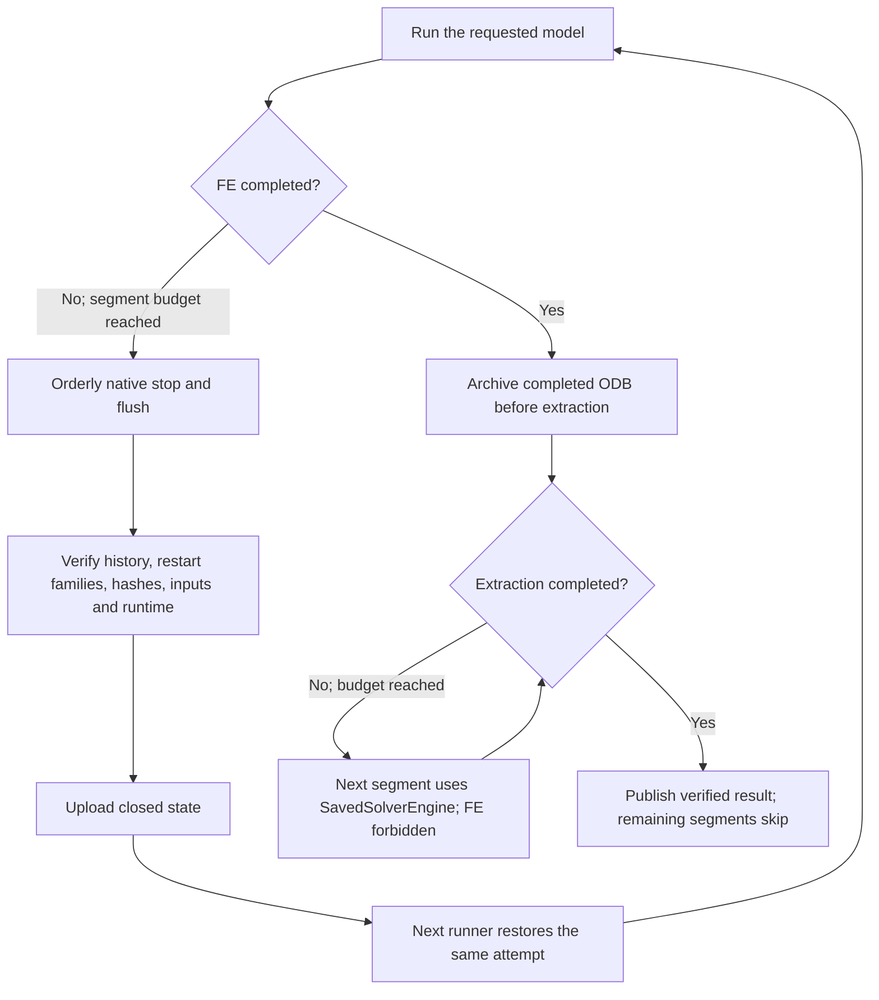

# Automatic native continuation

Research requests submitted through the web control plane now use
`abaqus-continuation.yml`; smoke and the full-field streaming workflow retain
their current execution paths. There are at
most four automatic segments. Each segment stops execution at 240 minutes from
runner startup, leaving 90 minutes within its 330-minute job for checkpoint
verification and transfer. This is a bounded continuation, not an infinite retry.

The native callback, material, mesh, contact, physical duration and measurement
frequency are unchanged. Continuation uses the previously accepted MPI callback
runtime. The four design inputs and original requested/resolved records remain
the scientific identity. Each recovered segment checks all inventoried state
bytes and original history before `recover` is admitted. A cleanup crash, missing
family, altered input or history gap blocks continuation rather than inventing
a usable checkpoint. Research scalar evidence is retained through every segment.

The legacy `abaqus-linux.yml` entry point also routes research requests into the
same verified segments. This admission rule applies even when a client still
uses the older web deployment or a CLI with the original workflow filename.
Completed restart receipts and earlier-horizon summaries are preserved; the
reserved release is published before any checkpoint download URL is generated.

## The already-running V14 batch

Workflow 43914437764 was admitted before this change and cannot acquire a callback
mid-solve. `automatic-native-continuation.yml` observes its completion event. Its
checked-in policy locks the exact parent, workflow, source, input digest and six
physical source modules. It keeps completed/reviewed siblings with verified
archives and selects only timeout cases or cases with a completed-ODB reference.
Cancellation and unrelated mechanical failures do not trigger recalculation.

A legacy timeout without a verified FE checkpoint needs one explicitly recorded
initial recalculation. It must never be labelled a continuation of the old partial
solve. The replacement uses the automatic segmented workflow; its subsequent
segments recover the same native attempt. A completed solver instead restores its
original ODB and uses an engine which forbids build, datacheck and FE solve.

The parent request and frozen prediction context are preserved. An additional
execution authorization records the reviewed source and source workflow; its
exception to the original source lock is valid only for the single pending
recovery. The controller compares the six physical files before reserving that
authorization. The original source, failed shard and workflow provenance remain
in the catalog history. The catalog claim is committed before dispatch; a lost
HTTP response leaves an inspectable claim, never a second automatic POST.

Manual dispatch of the observer while the source is active returns
`waiting_for_source`, without interrupting or duplicating its solvers. When every
case is already verified it returns `already_complete` and submits nothing.

## Verification

`tests/test_automatic_continuation.py` covers active sources, one-time claims,
retained siblings, cancellation, source/input mismatch, watchdog/hard timeout and
unrelated failures. `tests/test_explicit_continuation.py` checks original-attempt
recover, scalar metrics, ODB-only handoff, native history and state inventories.
The accepted native callback evidence remains
`docs/evidence/orderly-explicit-checkpoint.json`; unit tests do not replace native
state verification for the individual production cases.
